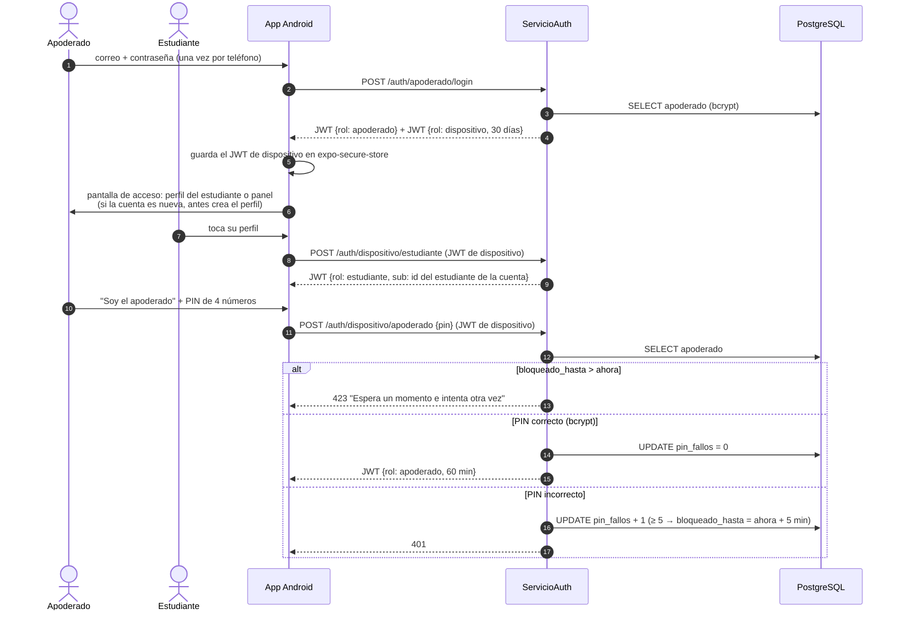
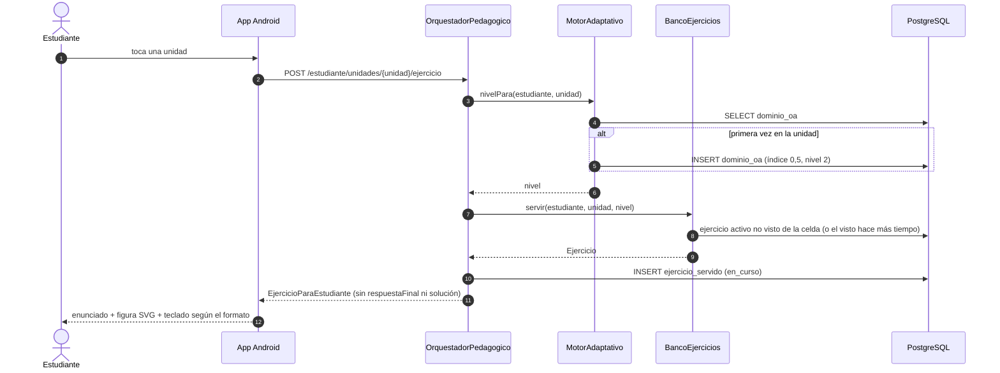
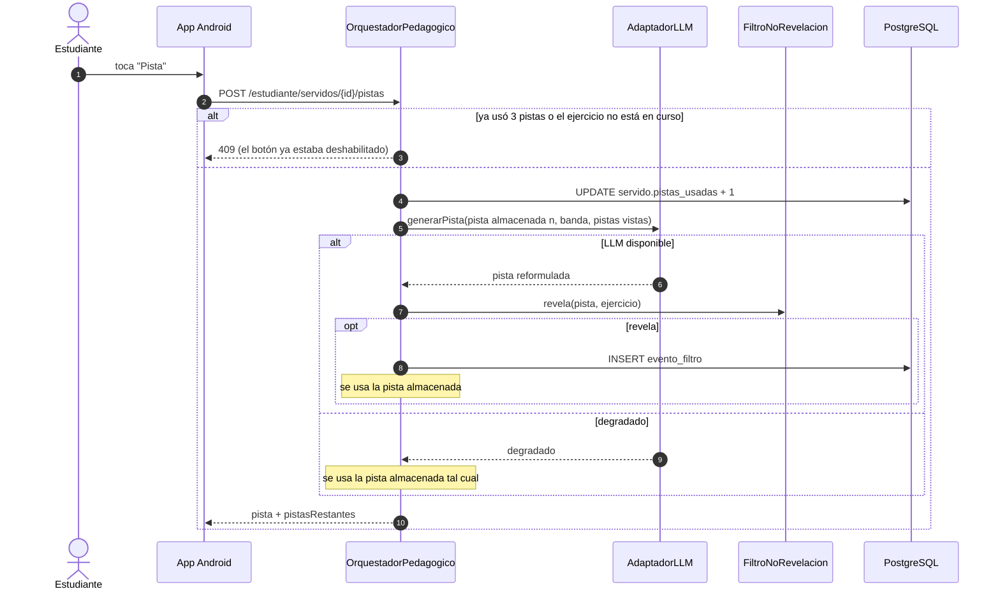
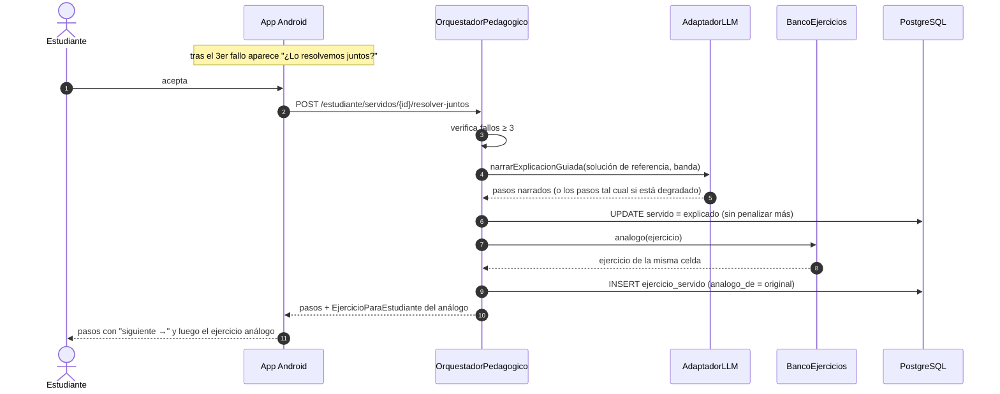
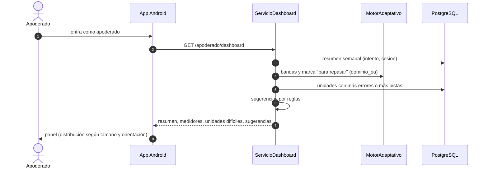
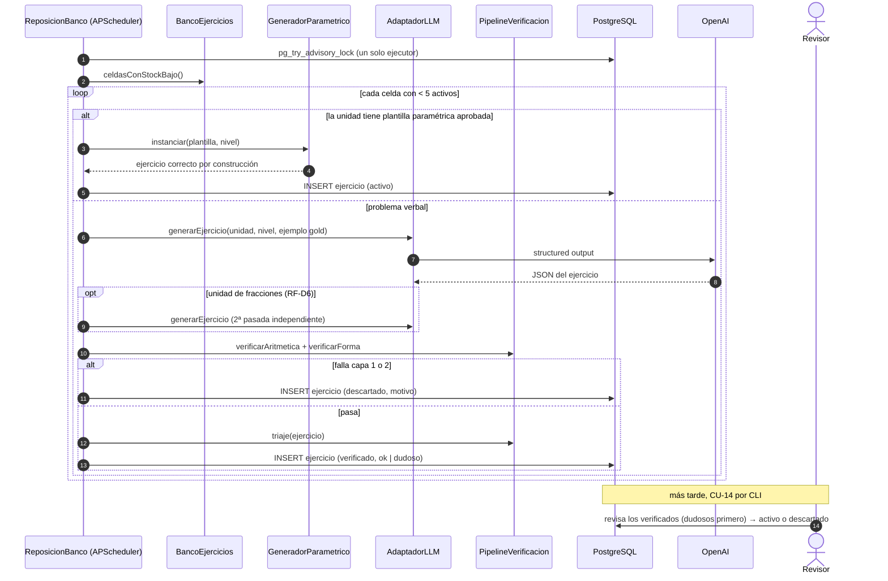

# Diagramas de Secuencia (Fase III, tarea 39)

**Proyecto:** Tutor inteligente basado en IA para el aprendizaje de matemáticas — eje de Números, 4°–6° básico.
**Documento:** Diagramas de secuencia de los flujos F1–F6 de `arquitectura.md` §5, más el acceso del estudiante y la explicación guiada. Usan las clases de `diagrama_clases.md` y las tablas de `modelo_base_datos.md`. En §1 se fija el contrato preliminar de la API que usan los diagramas, para que la app y el backend puedan avanzar en paralelo en la Fase IV.

---

## 1. Contrato preliminar de la API

Todas las rutas van sobre HTTPS con el JWT en la cabecera `Authorization` (salvo el registro y el login del apoderado). El rol del token restringe las rutas: `/estudiante/*` exige rol `estudiante`, `/apoderado/*` exige rol `apoderado` y `/auth/dispositivo/*` exige el token de `dispositivo`, que vincula el teléfono a la cuenta (§2).

| Método y ruta | Rol | Flujo | Respuesta (resumen) |
|---|---|---|---|
| `POST /auth/apoderado/registro` | — | CU-9 | apoderado creado |
| `POST /auth/apoderado/login` | — | CU-1 (§2) | JWT de apoderado + JWT de dispositivo |
| `POST /auth/dispositivo/estudiante` | dispositivo | CU-1 (§2) | JWT de estudiante (sin PIN) |
| `POST /auth/dispositivo/apoderado` | dispositivo | CU-1 (§2) | JWT de apoderado, con el PIN del panel |
| `POST /apoderado/estudiante` · `PATCH /apoderado/estudiante` | apoderado | CU-9 | perfil (alias, curso) |
| `PUT /apoderado/pin` | apoderado | CU-9 | cambia el PIN del panel |
| `GET /apoderado/dashboard` | apoderado | F4 | resumen semanal, medidores, unidades difíciles, sugerencias |
| `GET /estudiante/perfil` | estudiante | CU-6 | alias, curso y puntos |
| `GET /estudiante/unidades` | estudiante | CU-2 | unidades visibles con estrellas + unidad sugerida + `conEjercicios` (si ya hay ejercicios activos para practicarla) |
| `GET /estudiante/lecciones` | estudiante | CU-15 | lecciones de las unidades visibles, con sus partes (RF-D9; agregado 2-nov-2026) |
| `POST /estudiante/sesiones` · `POST /estudiante/sesiones/{id}/cierre` | estudiante | — | abre y cierra la sesión |
| `POST /estudiante/unidades/{unidad}/ejercicio` | estudiante | F1 | `EjercicioParaEstudiante` + id del ejercicio servido |
| `POST /estudiante/servidos/{id}/respuestas` | estudiante | F2 | `RespuestaTutor` |
| `POST /estudiante/servidos/{id}/pistas` | estudiante | F3 | `RespuestaTutor` |
| `POST /estudiante/servidos/{id}/no-entiendo` | estudiante | F2 | `RespuestaTutor` |
| `POST /estudiante/servidos/{id}/resolver-juntos` | estudiante | RF-P7 | pasos narrados + id del ejercicio análogo |
| `GET /estudiante/progreso` | estudiante | CU-6 | puntos, estrellas e insignias *(prevista; por ahora la pestaña Perfil usa `/estudiante/perfil` y `/estudiante/unidades`)* |

`RespuestaTutor` = `{ resultado: correcta | incorrecta | formato_invalido, mensaje, puntos, pistasRestantes, ofreceResolverJuntos, cambioNivel, degradado }`. Nunca contiene la respuesta final ni la solución de referencia.

## 2. Acceso: teléfono vinculado, estudiante y panel (CU-1)

*Actualizado el 2-nov-2026 (RF-A3).* El apoderado inicia sesión una vez por teléfono con correo y contraseña. La respuesta trae, además del JWT del panel (60 min), un **JWT de dispositivo** (30 días) que se guarda en `expo-secure-store` y solo sirve para dos cosas: entrar como el estudiante, sin PIN, y abrir el panel con el PIN del apoderado. El teléfono recuerda el perfil del estudiante de la cuenta vinculada (solo id, alias y curso), así el niño lo toca y entra. Cerrar sesión en el teléfono borra el JWT de dispositivo y el perfil recordado.

## 3. F1 — Servir ejercicio (sin LLM)

## 4. F2 — Responder: correcta e incorrecta (incluye F6)

```mermaid
sequenceDiagram
    autonumber
    actor E as Estudiante
    participant App as App Android
    participant O as OrquestadorPedagogico
    participant C as Corrector
    participant G as Gamificacion
    participant M as MotorAdaptativo
    participant A as AdaptadorLLM
    participant F as FiltroNoRevelacion
    participant P as PlantillasLocales
    participant DB as PostgreSQL
    participant LLM as OpenAI

    E->>App: escribe la respuesta y toca "Revisar"
    App->>O: POST /estudiante/servidos/{id}/respuestas {respuesta, tiempo}
    O->>C: corregir(respuesta, ejercicio)
    alt respuesta no parseable
        O-->>App: formato_invalido (no cuenta como intento)
    else correcta
        O->>G: puntosPor(intento, nivel)
        O->>DB: INSERT intento · UPDATE servido = resuelto · UPDATE puntaje
        O->>M: registrarIntento(intento)
        M->>DB: UPDATE dominio_oa (índice, racha, nivel)
        O->>P: refuerzo(banda, logro)
        O-->>App: correcta + refuerzo + puntos + cambioNivel
    else incorrecta
        O->>DB: INSERT intento · UPDATE servido.fallos + 1
        O->>M: registrarIntento(intento)
        M->>DB: UPDATE dominio_oa
        O->>A: generarRetroalimentacion(ejercicio, solución, respuesta, patrón, banda)
        alt LLM disponible y bajo el tope
            A->>LLM: prompt (solo contenido matemático)
            LLM-->>A: texto
            A->>DB: INSERT llamada_llm
            A-->>O: texto
            O->>F: revela(texto, ejercicio)
            alt revela la respuesta
                O->>DB: INSERT evento_filtro
                O->>P: errorSinLLM(ejercicio, patrón)
            end
        else circuito abierto, timeout o tope alcanzado (F6)
            A-->>O: degradado
            O->>P: errorSinLLM(ejercicio, patrón) + aviso
        end
        O-->>App: incorrecta + mensaje + ofreceResolverJuntos (si fallos ≥ 3)
    end
    App-->>E: Octavio responde
```

La ruta de respuesta correcta no llama al LLM (`modelo_pedagogico.md` §3). El alias se inserta en el servidor después del filtro, en el marcador `{nombre}` (`estrategia_llm.md` §4).

## 5. F3 — Pedir pista

El descuento de la pista se aplica al responder: `intento.pistas_usadas` copia el contador del ejercicio servido y lo usan `Gamificacion` y `MotorAdaptativo` (`modelo_estudiante.md` §1).

## 6. Resolver juntos (RF-P7)

Durante la narración el filtro deja pasar los pasos intermedios del ejercicio original, pero sigue bloqueando la respuesta del análogo (`modelo_pedagogico.md` §6).

## 7. F4 — Dashboard del apoderado (sin LLM)

## 8. F5 — Reposición del banco (asíncrono)

Si el Adaptador está degradado o sin presupuesto, el lote verbal se pospone al siguiente ciclo y el banco sigue sirviendo lo que tiene (`estrategia_llm.md` §3).
